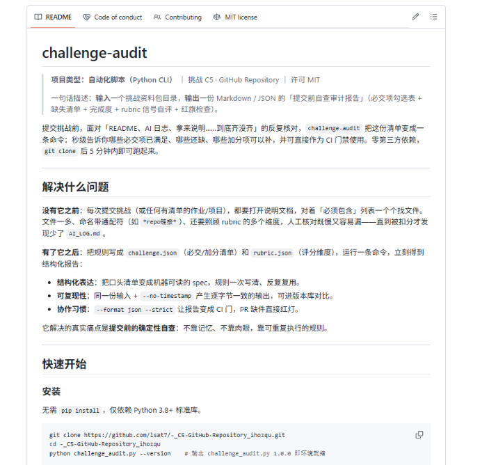

# challenge-audit

> **项目类型：自动化脚本（Python CLI）** ｜ 挑战 C5 · GitHub Repository ｜ 许可 MIT
>
> 一句话描述：**输入**一个挑战资料包目录，**输出**一份 Markdown / JSON 的「提交前自查审计报告」（必交项勾选表 + 缺失清单 + 完成度 + rubric 信号自评 + 红旗检查）。

提交挑战前，面对「README、AI 日志、拿来说明……到底齐没齐」的反复核对，`challenge-audit` 把这份清单变成一条命令：秒级告诉你哪些必交项已满足、哪些还缺、哪些加分项可以补，并可直接作为 CI 门禁使用。零第三方依赖，`git clone` 后 5 分钟内即可跑起来。

> **README 渲染效果预览**（GitHub 页面实际截图，完整 4 张见 [截图 1](./lsa_C5_readme截图.png) · [2](./lsa_C5_readme截图-2.png) · [3](./lsa_C5_readme截图-3.png) · [4](./lsa_C5_readme截图-4.png)）：
>
> 

---

## 解决什么问题

**没有它之前**：每次提交挑战（或任何有清单的作业/项目），都要打开说明文档，对着「必须包含」列表一个个找文件。文件一多、命名带通配符（如 `*repo链接*`）、还要照顾 rubric 的多个维度，人工核对既慢又容易漏——直到被扣分才发现少了 `AI_LOG.md`。

**有了它之后**：把规则写成 `challenge.json`（必交/加分清单）和 `rubric.json`（评分维度），运行一条命令，立刻得到结构化报告：

- **结构化表达**：把口头清单变成机器可读的 spec，规则一次写清、反复复用。
- **可复现性**：同一份输入 + `--no-timestamp` 产生逐字节一致的输出，可进版本库对比。
- **协作习惯**：`--format json --strict` 让报告变成 CI 门，PR 缺件直接红灯。

它解决的真实痛点是**提交前的确定性自查**：不靠记忆、不靠肉眼，靠可重复执行的规则。

---

## 快速开始

### 安装

无需 `pip install`，仅依赖 Python 3.8+ 标准库。

```bash
git clone https://github.com/lsat7/-_C5-GitHub-Repository_ihozqu.git
cd -_C5-GitHub-Repository_ihozqu
python challenge_audit.py --version    # 输出 challenge_audit.py 1.0.0 即环境就绪
```

### 使用

```bash
# 1) 审计某个目录（默认读该目录下的 challenge.json / rubric.json）
python challenge_audit.py examples/demo-good

# 2) 输出 JSON 并作为 CI 门：存在缺件时退出码为 1
python challenge_audit.py examples/demo-bad --format json --strict

# 3) 保存报告到文件，去掉时间戳以便可复现
python challenge_audit.py . --no-timestamp --out audit_report.md

# 4) 审计本仓库自身（dogfood），应全部 PASS
python challenge_audit.py . --no-timestamp --format json
```

> 目标目录里没有 `challenge.json` 也能运行：工具会退回内置默认清单并在报告中给出 WARN 提示。

常用参数：`--config PATH` 指定清单、`--rubric PATH` 指定评分维度、`--exclude GLOB` 追加排除模式（可重复）、`--strict` 把加分项缺失也视为失败。详见 `docs/usage.md`（若未展开，命令行 `python challenge_audit.py --help` 即完整帮助）。

---

## 示例

输入（一个只有 README、缺少其他必交项的目录 `examples/demo-bad/`）：

```text
examples/demo-bad/
├── challenge.json      # 必交：README.md, *repo链接*, *AI日志*, *拿来说明*
└── README.md           # 只有这一个交付物
```

运行：

```bash
python challenge_audit.py examples/demo-bad --no-timestamp
```

输出（真实运行截取，完整版见 [`examples/bad_report.md`](./examples/bad_report.md)）：

```markdown
## 总览
| 项 | 结果 |
|---|---|
| 必交项 | 1/4 PASS（25.0%） |
| 红旗 | 3 项触发 |

## 必交项勾选表
| 状态 | 要求 | 匹配模式 | 命中文件 |
|---|---|---|---|
| ✅ PASS | README.md | `README.md` | `README.md` |
| ❌ FAIL | *repo链接* | `*repo链接*` | — |
| ❌ FAIL | *AI日志* | `*AI日志*` | — |
| ❌ FAIL | *拿来说明* | `*拿来说明*` | — |

## 缺失清单
1. `*repo链接*` → 新建匹配 `*repo链接*` 的文件（建议命名 lsa_C5_…）.
2. `*AI日志*` → 新建匹配 `*AI日志*` 的文件（建议命名 lsa_C5_…）.
3. `*拿来说明*` → 新建匹配 `*拿来说明*` 的文件（建议命名 lsa_C5_…）.
```

对照的完整 PASS 案例见 [`examples/good_report.md`](./examples/good_report.md)（4/4 必交项 PASS、0 红旗）。

---

## 项目结构

```text
-_C5-GitHub-Repository_ihozqu/
├── README.md                       ← 本文件（项目说明）
├── LICENSE                         ← MIT 开源协议
├── .gitignore                      ← 排除缓存/虚拟环境/临时文件
├── requirements.txt                ← 仅注释：零第三方依赖
├── challenge_audit.py              ★ 主程序（唯一入口，零依赖）
├── challenge.json                  ← 本仓库交付清单（自审计输入）
├── rubric.json                     ← 本仓库评分维度（自审计输入）
├── AI_LOG.md                       ← AI 使用日志（多轮迭代）
├── ATTRIBUTION.md                  ← 拿来说明（借鉴来源）
├── AAR.md                          ← 事后复盘（姓名 lsa）
├── CHANGELOG.md                    ← 版本记录
├── CONTRIBUTING.md                 ← 贡献指南
├── CODE_OF_CONDUCT.md              ← 行为准则
├── 00_交付物索引.md                 ← 挑战要求 × 文件 × rubric 对照
├── lsa_C5_repo链接.md              ← 提交：仓库链接
├── lsa_C5_AI日志.md                ← 提交：AI 日志
├── lsa_C5_拿来说明.md              ← 提交：拿来说明
├── lsa_C5_readme截图*.png          ← 提交：README 渲染截图（4 张）
├── docs/
│   └── usage.md                    ← 详细用法与边界情况
├── examples/
│   ├── demo-good/                  ← 合格提交样本（4/4 PASS）
│   ├── demo-bad/                   ← 缺件提交样本（1/4 FAIL）
│   ├── good_report.md              ← 真实运行输出（PASS）
│   └── bad_report.md               ← 真实运行输出（FAIL）
├── tests/
│   └── test_challenge_audit.py     ← 23 个 unittest 用例
└── .github/
    ├── ISSUE_TEMPLATE/             ← bug / feature issue 模板
    ├── workflows/ci.yml            ← 3 OS × 3 Python 版本自动测试
    └── PULL_REQUEST_TEMPLATE.md    ← PR 模板
```

---

## 技术栈

- **语言**：Python 3.8+（开发与验证环境 3.13）
- **依赖**：仅标准库（`argparse` / `json` / `os` / `re` / `fnmatch` / `dataclasses` / `pathlib` / `typing` / `datetime`）——**无第三方包、无需联网**
- **测试**：`unittest`（23 个用例，覆盖 glob 语义、BOM JSON、红旗检测、退出码、渲染）
- **CI**：GitHub Actions（Ubuntu / Windows / macOS × Python 3.8 / 3.11 / 3.13）
- **输出**：Markdown（人读）与 JSON（CI 消费），`--strict` 支持非零退出码门禁
- **AI 集成**：无外部 API 调用；本项目全程用 AI 辅助开发，过程见 `AI_LOG.md`

---

## AI 生成说明

本项目使用 AI 辅助开发，**并非一句话直接生成后提交**：经历了选题评估、架构设计、编码、单测纠错、dogfood 自审计、README 撰写等多轮迭代，prompt 从 v1 进化到 v3，并由单元测试抓出并修复了 3 个真实缺陷。全过程详见 [AI_LOG.md](./AI_LOG.md)。

---

## 借鉴来源

本项目的规则清单结构参考了挑战方 `CHALLENGE.md` 的「必须满足的要求 / 提交内容」清单与 `rubric.json` 的五维评分模型；glob 匹配语义参考 Python `pathlib`/`fnmatch` 官方文档；报告结构与 CI 门禁思路参考了作者此前项目 `audit_deliverables.py`。逐项「拿了什么 / 改了什么 / 为什么改」详见 [ATTRIBUTION.md](./ATTRIBUTION.md)。

---

## License

MIT © 2026 lsa。详见 [LICENSE](./LICENSE)。
